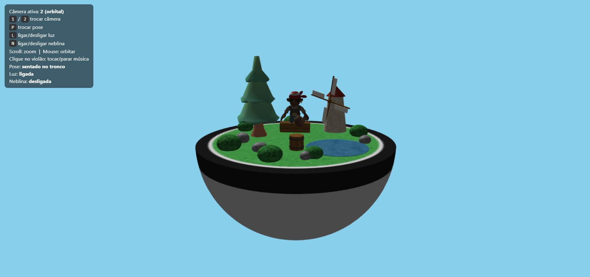
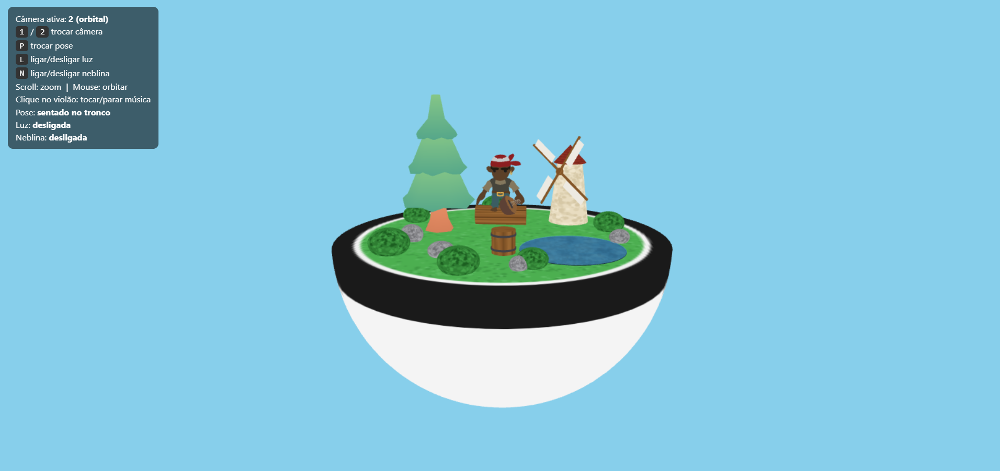
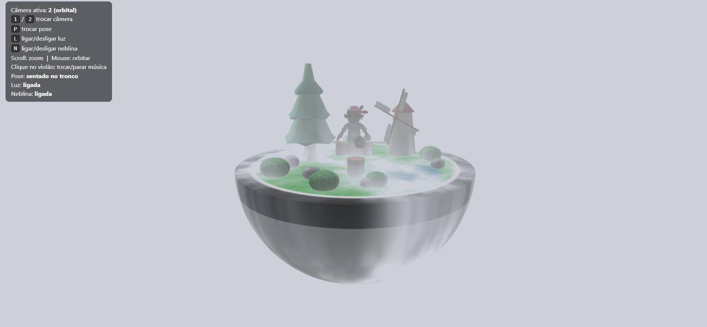

# Diorama Pokébola

Trabalho de Computação Gráfica (UFCIMG): um diorama 3D dentro de uma pokébola, feito com **WebGL2** e **TWGL.js**.

## (a) A Cena

Um minimundo em forma de pokébola: um disco gramado sobre um hemisfério branco com a faixa preta e o botão da pokébola. Sobre o gramado há uma árvore, arbustos, pedras, um tonel, um tronco caído, uma lagoa de água semitransparente e um moinho de vento cujas pás giram. O personagem é o pirata Henry, que alterna entre três poses (em pé olhando a lagoa, deitado de barriga para cima e sentado no tronco). A iluminação usa o modelo de Phong com uma luz direcional, e o cenário pode ficar envolto em neblina com fumaça.

### Controles

| Tecla / ação | Efeito |
|---|---|
| `1` | Câmera automática: ~45° acima do chão, girando ao redor do centro |
| `2` | Câmera orbital: arraste com o botão esquerdo do mouse (alvo fixo no centro) |
| Scroll | Aproxima/afasta a câmera do alvo |
| `P` | Alterna a pose do personagem (3 poses) |
| `L` | Liga/desliga o modelo de iluminação |
| `N` | Liga/desliga a neblina |

## (b) Criador(es)

- **Hugo Cardoso** — [hhdacardoso@gmail.com](mailto:hhdacardoso@gmail.com) · [github.com/hhdacardoso](https://github.com/hhdacardoso)
- **Custódio Junio** — [github.com/cjunio23](https://github.com/cjunio23)

## (c) Media kit

<!-- Screenshots em screenshots/: visão geral, personagem sentado e neblina ligada. -->

## (d) Opcionais

Itens opcionais implementados (texto copiado do enunciado):

- ⭐ **Modelos tridimensionais**: em vez de usar os sólidos próprios ou os da TWGL.js, crie ou use modelos tridimensionais de terceiros e carregue-os no seu programa. Um formato simples é o `.obj` (mas ele não suporta animação). Tem também o formato glTF (mais complexo mas suporta animação)
  - *Como foi feito:* um parser próprio de `.obj` (`parseObj` em `main.js`) lê posições, normais e coordenadas de textura, triangula faces com mais de 3 vértices e desindexa os vértices. Dois modelos de terceiros são carregados: a **árvore** (`models/tree.obj`) e o **personagem** (`models/personagem.obj`), cada um com a sua textura.

- **Vários tipos de objetos**: Ambiente composto por 7 tipos de objetos diferentes
  - *Como foi feito:* o cenário tem 7 tipos de objeto: árvore (`.obj`), arbustos, pedras, tonel (com aros de metal), lagoa, tronco caído e moinho de vento (hierárquico).

- **Líquido**: tenha uma região aquática como um lago, poça d'água, mar ou rio. Uma ideia para que um sólido pareça água é que ele (a) tenha certa transparência, (b) tenha uma textura com suas coordenadas animadas e (c-para oceano ou rio agitado) desloque verticalmente os vértices da superfície ao longo do tempo para criar ondas
  - *Como foi feito:* a lagoa é composta por um leito opaco e por uma superfície de água semitransparente (mistura com alfa), desenhada em uma segunda passada, depois dos objetos opacos, com textura de água e material de brilho especular alto.

- **Neblina**: funcionalidade acrescentada por comando do teclado (`N`), podendo ser habilitada e desabilitada durante a execução
  - *Como foi feito:* no fragment shader, névoa por distância (de 8 a 30 unidades do olho) somada a manchas de fumaça geradas por ruído que se deslocam com o tempo, mais densas perto do chão. A cor de fundo acompanha a cor da névoa e o estado aparece no painel.

## (e) Créditos

Recursos de terceiros:

- **Árvore** (`models/tree.obj`, `colormap.png`): [Kenney](https://kenney.nl) — licença CC0. [PREENCHER: nome do pacote, ex.: Nature Kit, com o link de https://kenney.nl/assets]
- **Personagem Henry e textura `Atlas_Pirate.png`**: [Kenney — Pirate Kit](https://www.kenney.nl/assets/pirate-kit) — licença CC0.
- **TWGL.js**: biblioteca de apoio ao WebGL, de Gregg Tavares — [twgljs.org](https://twgljs.org) · [GitHub](https://github.com/greggman/twgl.js).

As demais texturas (grama, pedra, madeira, água, telhas, tecido e pokébola) são geradas por código com `canvas`, e os sólidos do cenário e do moinho vêm das primitivas da TWGL.js.
